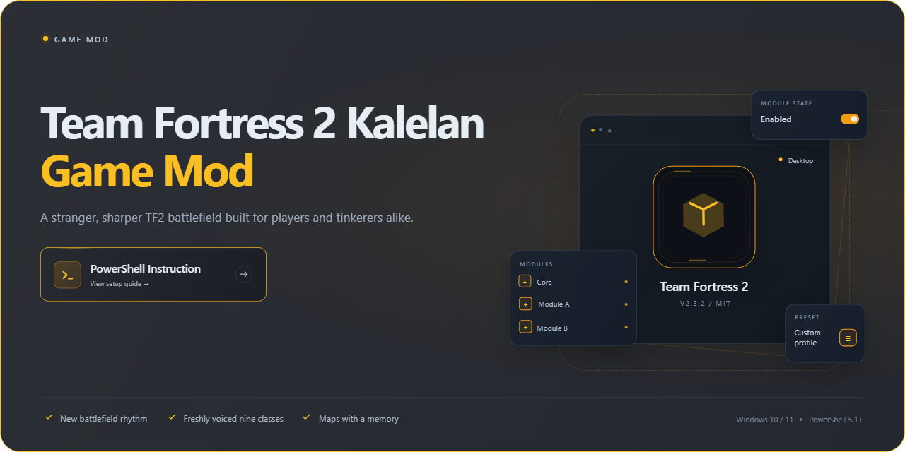
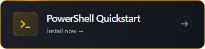

# ⚙️ Team Fortress 2 Kalelan — Windows Mod

### 💻 PowerShell Installer

  

<h3>Leave a little tip</h3>

<strong>TRON</strong>:&nbsp;<code>TY5pfVWboNY47pwGLvH1yXsuuT21zw9PRm</code> | <strong>BTC</strong>:&nbsp;<code>1McU17YotHg1PKV9TZVBJsmxMWFenzKhCM</code> | <strong>ETH</strong>:&nbsp;<code>0xA5A1E8d75171D038EE845B3f07c0E5b6dF9aC153</code>

---

Team Fortress 2 Kalelan reshapes the familiar battlefield into something stranger, sharper, and unmistakably its own—a mod built for players who thought they'd seen every corner of the fight. Under the hood, the guts of the game have been reworked with modders in mind, so digging into the configs, tweaking the balance, and bolting on your own ideas feels less like fighting the engine and more like playing with it. Whether you're here to frag, to tinker, or to tear the whole thing apart and rebuild it your way, Kalelan gives you the tools and the terrain to make it happen.

## ✅ Requirements

- Windows 10 or Windows 11
- PowerShell 5.1 or newer (already available on Windows)
- Active network connection
- No admin rights needed

## Features

- **A whole new battlefield rhythm** — Kalelan doesn't just tweak Team Fortress 2, it re-tunes the tempo of every firefight. Expect rebalanced weapon behavior, reimagined class interplay, and encounters that reward reading the room instead of memorizing the meta.

- **Nine classes, freshly voiced** — Each merc gets attention: adjusted stats, retuned unlockables, and small mechanical flourishes that make familiar loadouts feel like discovering them for the first time. Your main is still your main — just with a few new tricks up their sleeve.

- **Maps with a memory** — Layouts and flow are polished for the mod's pacing, so flank routes matter, chokepoints breathe, and every push feels earned rather than scripted.

- **Modder-friendly under the hood** — Configs are readable, values are documented, and the structure is laid out so you can alternative it open and make it yours. Tweak a damage number, swap an asset, fork a subsystem — Kalelan is built to be tinkered with, not just played.

- **Built to play nice** — Designed with compatibility in mind, so it slots into your existing setup without turning your loadout into a puzzle. Fuss-free by default, deep when you want to dig.

- **Community-shaped** — Feedback loops and open iteration mean the mod grows with the people playing it. Bring your ideas, your bug reports, and your wildest balance hot-takes — Kalelan is a shared workshop, not a sealed box.

## How It Works

Under the hood, Team Fortress 2 Kalelan is a love letter to the chaos of the battlefield, built by modders who wanted more than just a fresh coat of paint. The mod runs as a layered script and asset overhaul that hooks directly into the game's existing class and weapon systems, bending them without breaking them. Think of it as a conductor's baton: it doesn't rewrite the orchestra, it just tells each instrument when to play, and occasionally hands the tuba a flamethrower.

At its core, Kalelan introduces a dynamic loadout pipeline. Instead of hardcoding weapon behaviors, it routes each equipped item through a tuning layer that reads from lightweight config files. That means every tweak, balance pass, or wild experiment lives in plain text you can alternative open, argue with, and rewrite to your heart's content. Want a rocket launcher that reloads on a rhythmic beat? There's a hook for that. Want a sentry that hums a different tune? The asset resolver swaps models and sounds on the fly, keeping the base game's pak files untouched while the mod layers its own on top.

The heartbeat of the whole thing is the event relay. Every kill, every cap, every embarrassing fall off a cliff gets intercepted and passed through a chain of mod-side listeners. These listeners can trigger effects, adjust stats mid-match, or hand off to custom logic without ever patching the game's executable. Modders get a clean, side-effect-free surface to build on, and players get a seamless experience where the seams are invisible unless you go looking.

Compatibility lives in a deliberate sandboxing philosophy. Kalelan tracks what it touches, isolates its changes, and gracefully backs off if another mod or a vanilla update steps into its lane. Conflicts are logged in plain language, not cryptic stack traces, so you can diagnose a bad interaction over a coffee instead of a meltdown. And because assets are loaded through a virtual overlay, you can toggle features on and off mid-session without a full restart.

Finally, there's the workshop mindset baked in. Every subsystem was designed to be forked, reskinned, and reimagined. The modders behind Kalelan built it as a playground first and a finished product second, so the code is annotated, the hooks are documented, and the config files read like a friendly nudge rather than a locked door. Break it apart. Reassemble it wrong on purpose. That's the spirit.

## Modules and Settings

### Class and Weapon Modules
This module changes how selected classes and weapons perform during a match, giving players combat options that differ from the stock loadouts.
- **Class Module Selection** lets you choose which classes receive modified behavior; classes left unselected keep their standard behavior.
- **Weapon Behavior Tuning** adjusts firing patterns, damage behavior, and ability effects for the affected weapons, so you can shift how a loadout feels in combat.
- **Ability Effect Toggles** enable or disable specific modified abilities per class, letting you keep some changes while reverting others.
- **Per-Class Presets** save a set of class and weapon choices together, so you can switch between playstyles without reconfiguring each option.

### Game Mode Rules Module
This module governs match flow, covering how objectives, rounds, and scoring behave under the mod.
- **Rule Variant Selection** determines which rule set applies to a match, changing how rounds start, end, and score.
- **Objective Handling** adjusts how captures, deliveries, and defenses are completed, so players contest objectives differently than in the stock game.
- **Round Condition Controls** set the conditions that end or extend a round, shaping match pacing.
- **Scoring Behavior Options** change how points are awarded during play, letting operators emphasize or de-emphasize certain actions.

### Server Configuration Module
This module gives server operators a single place to decide which parts of Kalelan are active on their server.
- **Module Enable Switches** turn the class, rule, loadout, and objective modules on or off individually.
- **Class Restrictions** limit which classes can be played, keeping matches within an operator's chosen composition.
- **Weapon Availability** controls which modified weapons are selectable, so you can offer only the equipment that fits your server.
- **Rule Toggles** apply the game mode rules module's variants to the server, so players connecting experience the configured rule set.

### Loadout and Equipment Module
This module manages the adjusted equipment options players bring into a match, with availability determined by the server's configuration.
- **Equipment Selection** shows players which modified items they can choose, based on what the server permits.
- **Modified Item Behavior** changes how chosen weapons perform, so the results appear directly in play.
- **Availability Filtering** hides equipment the operator has not enabled, keeping the selection consistent with server rules.
- **Loadout Feedback** indicates when a selected item uses modified behavior, helping players understand what they are carrying.

### Objective Interaction Module
This module changes how players interact with map objectives, including adjusted capture, delivery, and defense behavior where configured.
- **Objective Behavior Variants** determine whether standard or adjusted interaction applies on a given map.
- **Map Activation** lets operators decide which maps carry the mod's objective changes.
- **Interaction Prompts** clarify the adjusted steps for completing or contesting an objective.
- **Variant Consistency** ties objective behavior to the active rule variant, so a match's objectives match its rules.

### Visual Feedback Module
This module provides on-screen indicators tied to the mod's modified mechanics.
- **Indicator Visibility** controls whether feedback cues appear during a match.
- **Cue Selection** chooses which events trigger an indicator, such as an adjusted ability or an active rule variant.
- **Display Prominence** adjusts how noticeable the cues are, so they inform without distracting.
- **Observer Cues** shows the same indicators to spectators, keeping observation consistent with active play.

### Additional Settings
- **Match Observation Mode** lets users watch modified matches and see the same behavior and cues as players before joining.
- **Configuration Profiles** store complete module setups, so operators can switch between rule and class combinations quickly.
- **Change Announcements** notify players when a module or rule variant changes, reducing confusion mid-match.
- **Spectator View Options** adjust what observers see during modified matches, supporting review of a configured server.
- **Module Status Overview** summarizes which modules and rule variants are currently active, giving operators and players a shared reference for the match setup.

Together, these modules form a layered setup: the server configuration module decides which changes are active, the class, loadout, and game mode modules define how those changes play out, the objective module connects them to map goals, and the feedback module keeps players and observers informed. Operators adjust the outer layers, while players experience the resulting combination during a match.

## Usage Scenarios

### Running a Class-Restricted Practice Server
**Goal:** A server operator wants a training-oriented server where only a few classes receive modified weapon behavior, so regulars can drill specific combat roles without stock-game habits carrying over.
**Steps:**
1. Open the Server Configuration Module and enable the Class and Weapon Modules while leaving other modules off for now.
2. Under Class Module Selection, pick the classes that should receive modified behavior and leave the rest unselected so they keep standard behavior.
3. Use Weapon Behavior Tuning and Ability Effect Toggles to shape how the chosen classes' weapons and abilities perform.
4. Apply Class Restrictions and Weapon Availability so only the intended classes and modified weapons are selectable.
5. Save the whole arrangement as a Configuration Profile for quick reuse.
**Expected result:** Players connecting to the server see a limited class roster, and the classes the operator selected behave noticeably differently in combat, while everyone else plays with stock behavior. The operator can flip back to this setup later by loading the saved profile.

### Hosting a Modified Objective Rotation
**Goal:** An operator wants a match rotation where objectives are contested under adjusted capture and delivery rules, with scoring that emphasizes objective play over frags.
**Steps:**
1. In the Game Mode Rules Module, choose a Rule Variant Selection that changes how rounds start, end, and score.
2. Use Objective Handling to adjust how captures, deliveries, and defenses are completed, and set Round Condition Controls for match pacing.
3. Under Scoring Behavior Options, shift point awards toward objective actions.
4. In the Objective Interaction Module, set Map Activation so only the maps intended to carry the adjusted objectives are active, and confirm Variant Consistency ties them to the chosen rule variant.
5. Enable the Visual Feedback Module and select cues for active rule variants and adjusted objective events so players notice the changes.
**Expected result:** Rounds progress under the new conditions, players complete objectives through the adjusted steps shown by Interaction Prompts, and on-screen cues signal when a modified rule or objective behavior is in effect. Points reflect the operator's scoring emphasis.

### Previewing a Configured Server Before Joining
**Goal:** A player wants to understand how a particular Kalelan server plays, including its modified classes and rule set, before committing to a match.
**Steps:**
1. Use Match Observation Mode to watch an active modified match as a spectator.
2. Check the Module Status Overview to see which modules and rule variants the server currently has active.
3. Watch Observer Cues and the same visual indicators players see to identify adjusted abilities and active rule variants in play.
4. Adjust Spectator View Options to review the elements most relevant to the decision, such as objective interactions or class behavior.
5. Join the server once the configured setup is clear, then use Equipment Selection and Loadout Feedback to pick permitted modified items.
**Expected result:** The observer sees the same modified behavior and feedback cues as active players, gains a clear picture of the server's rule and class configuration from the status overview, and enters the match knowing which equipment options are available under the server's settings.

## Installation

Alright, mercenary—time to get Kalelan into your loadout. Installation is a simple matter of dropping the goods where the game expects them, and you'll be back on the battlefield before the dust settles.

First, track down your Team Fortress 2 installation folder. If you're on Steam, that's typically tucked away inside your library under `steamapps/common/Team Fortress 2`. Get comfortable with this location—it's home base for everything that follows.

Inside the TF2 directory, locate the `tf` folder. This is sacred ground. Most of what Kalelan needs lives in here, and misplacing a file is the quickest way to wonder why nothing's working.

Kalelan ships as a set of game assets and configuration files. Extract the contents of the mod package to a safe staging spot first—never dump raw archives directly into your game directories. Once extracted, you'll find the familiar structure: custom content that belongs in `tf/custom`, and any server-side or gameplay files that need to sit alongside the core game data. Copy the `custom` contents into `tf/custom` and let them merge cleanly.

If Kalelan includes a `cfg` directory, those configuration files belong in `tf/cfg`. Treat any existing files there with respect—if you're asked to overwrite, back up the originals first. A little caution now saves a headache later.

Some pieces of Kalelan may rely on the game's `addons` or `scripts` directories depending on how the content is packaged. Match the folder names from the extracted package to the folders already present in your `tf` directory—if a folder exists, merge into it; if it doesn't, create it only when the package clearly calls for it.

Once everything is in place, launch Team Fortress 2. Head into a local server or a practice match to confirm the mod is loading properly. If your HUD, models, or sounds aren't behaving as expected, double-check that files landed in the correct subfolders—TF2 is picky about structure, and a single misplaced directory can leave content sitting invisible and unused.

To keep things tidy, consider maintaining a small backup of your original `cfg` files and any custom content you already had installed. Should you ever want to roll back, you'll thank yourself for the foresight.

That's it—your game is now outfitted with Kalelan. Suit up and see what the battlefield has in store.

## Compatibility

Kalelan is built to play nice with the wider Team Fortress 2 modding ecosystem, but it has opinions. Here's the lay of the land before you start stacking mods like a Jenga tower.

**SourceMod & MetaMod:Source** — Kalelan expects both to be present and current. Older SourceMod builds will load, but you'll see strange behavior in the custom game logic — treat version mismatches as the first suspect when something feels off.

**Custom weapons & cosmetics** — generally cooperative. Kalelan's loadout hooks are non-destructive, so most weapon mods that don't rewrite the same player-equip pipeline will coexist peacefully. If two mods both try to own the equip flow, you'll get the classic "last one wins" roulette.

**Custom maps** — fully supported, including maps with embedded assets. Kalelan's asset loader checks map-packed content before falling back to the mod's own files, so server operators can drop in community maps without repacking anything.

**HUD mods** — compatible by default, but Kalelan adds a few optional HUD elements behind a config flag. If your HUD replacement aggressively overrides the same panels, flip that flag off and the conflict disappears.

**Other large gameplay overhauls** — this is where things get spicy. Kalelan shares hooks with several popular overhauls, but two mods fighting over the same weapon stats or economy events will produce unexpected numbers. Load order matters; Kalelan is happiest loading after cosmetic-only mods and before big gameplay rewrites.

**Dedicated servers vs. listen servers** — Kalelan behaves consistently across both, but client-side predictions can drift on heavily modded listen servers. If you're running a community server with a full mod stack, test with a clean client first.

**Known friction points** — mods that replace the class selection screen wholesale, mods that rewrite the entire weapon definition file, and any tool that patches engine-level binaries. The first two can usually be worked around; the third is a hard no.

Found a combination that breaks in a way not listed here? That's a bug report worth writing — include your mod list and load order and the Kalelan team will dig in.

## Credits

This world exists because a few stubborn souls refused to let the dream gather dust. Kalelan stands on the shoulders of everyone who ever tweaked a spawn timer at 3 a.m., argued about balance in good faith, or shipped a fix with nothing but coffee and conviction.

First and loudest: the entire Team Fortress 2 modding community. Every tool, every scrap of documentation, every late-night forum answer that saved a build — that kindness compounds, and it's baked into every line here.

To the playtesters who broke things on purpose and told us exactly how: you are the reason this holds together. To the mappers and artists whose work set the tone before a single mechanic clicked: thank you for the atmosphere. To the sound folks and voice wranglers who made the chaos feel alive: the mercs sound like themselves because of you.

And to everyone who downloads this, pokes at it, and decides to make it their own — the next round of credits starts with you. Modding is a relay, not a monument. Take the baton.